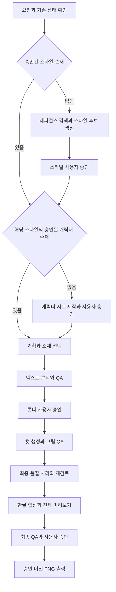

# 인스타툰 자동화 설계

> 현재 저장 구조는 v2입니다. series.json·episode.json에 정보를 통합하고 history.jsonl에 이력을 누적합니다. 상세 API와 이전 방식은 [데이터 계약](../references/contracts.md)과 [tool 문서](../references/tools.md)를 따릅니다. 아래 과거 파일 분리 설계보다 v2 계약을 우선합니다.

주제 입력부터 PNG 출력까지 에이전트가 제작을 진행하고, 사용자가 스타일·캐릭터·콘티·최종 결과를 승인한다. 전체 진행 스킬 1개와 전문 스킬 6개를 연결하며, 컷별 결과와 승인 버전을 파일에 저장해 다음 대화에서도 작업을 이어간다.

현재 7개 스킬과 공통 ref를 마크다운으로 작성했다. 상태 저장·한글 합성·미리보기·에피소드 승인·출력 CLI를 구현했다. 검색·생성 어댑터와 별도 JSON Schema는 아직 구현 전이다. [전체 진행 스킬](../skills/instatoon/SKILL.md)에서 작업별 문서로 연결되며, 실제 기능 상태는 [tool 현황](../references/tools.md)에서 관리한다. 기준 문서는 [제작 계획](plan.md), [제작 참고 내용](roadmap.md), [QA 기준표](QA기준표.md)다. 이 설계에서 추가한 초기 기본값은 실제 한 편 제작 후 조정한다.

## 범위와 제작 원칙

- 첫 검증은 스타일 1개, 주인공 1명, 4~6컷 단편으로 진행한다. 이후 여러 캐릭터와 연재로 확장한다.
- 에피소드는 최대 10컷이다. 초기에는 한 컷을 정사각형 PNG 한 장으로 대응한다.
- 그림에는 글자와 말풍선을 생성하지 않는다. 대사·내레이션·효과음은 별도 데이터로 저장하고 코드로 합성한다.
- 내부 배치 좌표는 1920×1920을 기준으로 하며, 1920×1920과 1080×1080 PNG를 모두 출력한다. 생성 모델의 원본 크기와 내부 작업 크기는 구분한다.
- 캐릭터 시트와 스타일 기준 이미지를 참조한다. 직전 컷을 다음 컷의 캐릭터 참조로 사용하지 않는다.
- 최종 품질 처리와 합성을 끝낸 결과를 승인받는다. 승인 후에는 새로운 그림을 생성하지 않는다.
- 초기 범위는 로컬 제작과 출력이다. 편집용 웹 UI, 게시 연동, 댓글 분석, LoRA 학습은 후속 범위다.

## 시작 문서와 스킬 로딩

사용자가 자연어로 인스타툰 제작을 요청하면, 에이전트는 저장소의 [AGENTS.md](../AGENTS.md)에 정의된 진입 규칙에 따라 [PROMPT.md](../PROMPT.md)를 읽는다. 사용자가 파일명이나 스킬명을 지정할 필요는 없다. `PROMPT.md`는 전체 진행 스킬 `skills/instatoon/SKILL.md`로 연결하는 단일 진입점이다. 이 연결은 저장소의 `AGENTS.md`를 읽는 에이전트 환경에서 적용된다.

```text
사용자의 인스타툰 제작 요청
  → AGENTS.md의 요청 인식 규칙
  → PROMPT.md
  → skills/instatoon/SKILL.md
  → 현재 요청과 저장 상태 확인
  → 필요한 전문 SKILL.md
  → 해당 단계의 ref와 tool
  → 결과 저장과 다음 단계 또는 사용자 승인
```

시작 문서는 사용자 요청의 범위와 진입 절차를 정의한다. 전체 진행 스킬은 실행 순서와 상태를 관리하며, 전문 스킬은 제작 판단과 절차를 담당한다. 처음부터 모든 스킬과 ref를 읽지 않는다. 스킬이 아직 없는 동안에는 설계 문서와 실제 구현 상태를 확인하고 사용자가 요청한 설계·구현 범위에서 작업한다.

사용 예시: “직장인의 월요일을 주제로 인스타툰 제작해줘.” 기존 작업은 프로젝트나 에피소드를 지정해 이어갈 수 있다. 설계 논의나 문서에 인용된 예시를 제작 실행 요청으로 취급하지 않는다.

## 스킬의 책임

| 스킬 | 읽는 입력 | 책임 | 저장하는 결과 |
| --- | --- | --- | --- |
| `instatoon` | 사용자 요청, 시리즈와 에피소드 상태 | 요청 분류, 단계 연결, 승인 확인, 재개와 부분 수정 | 진행 상태와 승인 기록 |
| `instatoon-planning` | 주제 또는 사용자 정보, 독자, 시리즈 설정 | 소재 후보, 공감·재미 요소, 단편 결말 또는 연재 방향 | 선택된 기획 `brief.json` |
| `instatoon-style` | 주제·독자·분위기, 선택적 사용자 레퍼런스 | 레퍼런스 검색·분석, 스타일 후보와 샘플 제작, 선택·수정 반영 | 출처 기록, 승인된 스타일 가이드와 기준 이미지 |
| `instatoon-character` | 캐릭터 설명, 승인된 스타일 가이드, 기존 시트 | 외형 명세, 정면·3/4·주요 표정 시트 제작과 검토 | 캐릭터 명세와 시트 버전 |
| `instatoon-storyboard` | 기획, 승인된 캐릭터·스타일 | 컷 분할, 장면 의도, 구도, 대사, 읽는 순서, 콘티 QA | `storyboard.json` |
| `instatoon-drawing` | 승인된 콘티, 원본 캐릭터 시트, 스타일 참조 | 컷 생성, 캐릭터·장면 QA, 필요한 최종 품질 처리 | 글자 없는 그림과 생성 기록 |
| `instatoon-lettering` | 그림, 콘티의 텍스트, 스타일의 식자 기준 | 말풍선·한글 배치, 합성, 가독성 QA, 미리보기와 출력 | 배치 데이터, 합성본, PNG |

전문 스킬은 단독으로 사용할 수 있다. “콘티만 작성”은 콘티 결과까지 저장하고 끝낸다. 전체 진행 스킬은 필요한 전문 스킬을 순서대로 읽어 실행한다. 스킬 분리가 별도 에이전트 실행을 요구하지는 않는다.

전문 스킬은 자기 산출물을 만들고 검토한다. 전체 진행 스킬은 산출물 간 버전 일치와 승인 여부를 확인한다. 모든 스킬은 공통 데이터 계약에 따라 상태를 기록하므로, 단독 실행 후에도 전체 흐름에서 재개할 수 있다. 에피소드 상태는 save_revision으로 저장한다. 스타일·캐릭터 자원은 현재 에이전트가 파일과 승인 기록을 관리한다.

## 파일 구성

아래는 목표 구조다. schemas와 이미지 생성 관련 기능은 아직 구현하지 않았다. 현재 export는 snapshot 외부의 episodes/<id>/exports/<revision>/에 저장하며 실제 호출 규격은 tool 문서를 따른다.

```text
AGENTS.md                    # 자연어 제작 요청을 PROMPT.md로 연결
PROMPT.md                    # 제작 절차의 진입점
skills/
  instatoon/SKILL.md
  instatoon-planning/SKILL.md
  instatoon-style/SKILL.md
  instatoon-character/SKILL.md
  instatoon-storyboard/SKILL.md
  instatoon-drawing/SKILL.md
  instatoon-lettering/SKILL.md
references/
  contracts.md
  workflow.md
  planning.md
  style.md
  character.md
  storyboard.md
  drawing.md
  lettering.md
  qa.md
  tools.md
schemas/
  style.schema.json
  character.schema.json
  series.schema.json
  episode.schema.json
  brief.schema.json
  storyboard.schema.json
  layout.schema.json
  qa.schema.json
tools/
  instatoon/                 # 스킬들이 공유하는 실행 코드
assets/
  fonts/
outputs/<series-id>/
  series.json
  styles/<style-id>/<revision>/
    style.json
    sources.json
    samples/
  characters/<character-id>/<revision>/
    character.json
    sheet.png
  episodes/<episode-id>/
    episode.json
    revisions/<revision>/
      brief.json
      storyboard.json
      panels/<panel-id>/
        generation.json
        art.png
        layout.json
        composed.png
      qa/
      preview.png
      exports/1920/
      exports/1080/
      export-manifest.json
```

각 `SKILL.md`는 역할, 필수 입력, 절차, 완료 조건과 관련 ref 링크만 담는다. 공통 규격과 QA 기준은 복제하지 않는다. 저장소의 `references/`와 `tools/` 경로는 스킬에서 상대 경로로 연결한다. 독립 배포가 필요해지면 공통 파일을 포함하는 패키징 방식을 별도로 정한다.

`outputs/`는 현재 Git 제외 대상이므로 생성물과 진행 상태는 로컬에 남는다. 기기 간 작업이나 복구가 필요하면 별도 저장·백업 수단을 추가한다.

## Ref 작성 범위

| Ref | 포함할 내용 | 주로 읽는 스킬 |
| --- | --- | --- |
| `contracts.md` | ID, 버전, 좌표, 산출물 참조, JSON 예시 | 모든 스킬 |
| `workflow.md` | 단계 전환, 승인, 중단과 재개, 변경 영향 | 전체 진행 |
| `planning.md` | 사용자 정보·키워드에서 소재 도출, 후보 선택, 단편·연재 기준 | 기획 |
| `style.md` | 레퍼런스 검색·출처 기록, 시각 특징 분석, 후보 비교와 스타일 확정 | 스타일 |
| `character.md` | 등신·종류, 고정 특징, 시트 구성, 일관성 판단 예시 | 캐릭터 |
| `storyboard.md` | 컷의 역할, 대사 밀도, Z자 시선, 배경 필요성 | 콘티 |
| `drawing.md` | 참조 전달, 장면 프롬프트 구성, 수정과 최종 품질 처리 | 그림 |
| `lettering.md` | 폰트, 줄바꿈, 말풍선·꼬리, 여백, 축소본 검토 | 식자 |
| `qa.md` | 단계별 판정, 심각도, 수정 책임, 통과·실패 예시 | 해당 단계 |
| `tools.md` | 실제 호출법, 입력·출력, 지원 기능, 오류·재시도 | tool 실행 시 |

스타일 가이드는 에이전트가 생성하는 산출물이다. 사용자가 미리 스타일 팩을 준비할 필요는 없다. 스타일 스킬이 주제·독자·분위기를 바탕으로 레퍼런스를 검색하고 원문 URL과 분석한 특징을 `sources.json`에 기록한다. 동일 장면으로 서로 다른 스타일 샘플 2~3개를 생성해 비교하고, 사용자 선택과 수정을 반영해 승인 버전을 저장한다. 사용자 제공 레퍼런스는 선택 입력이다. 검색을 수행하지 못했다면 그 사실을 표시하고 검색 결과로 꾸미지 않는다.

`style.json`에는 색상, 선 표현, 형태의 단순화 정도, 배경 밀도, 폰트·말풍선 규칙과 승인된 샘플 경로를 둔다. 캐릭터의 종류·등신·외형·고정 특징은 `character.json`에서 관리한다. 스타일 후보의 샘플 인물은 비교용이며 승인된 캐릭터로 취급하지 않는다. 캐릭터 스킬은 승인된 스타일을 받아 인물별 시트를 만든다. 펜선 기준은 스타일 큐레이션에서 정의하고 결과를 눈으로 검토한다. 정확한 선 굵기를 모델이 보장한다고 가정하지 않는다.

기존 QA 기준표를 기준으로 `qa.md`를 작성한다. 새 ref를 실제 제작 기준으로 전환할 때는 기존 문서에서 링크하도록 정리해 서로 다른 기준이 병행되지 않게 한다.

## 입력과 데이터 계약

사용자는 주제 한 줄로 시작할 수 있다. 시스템이 소재 후보와 설정 초안을 제시한다. 독자·톤·컷 수가 없으면 제안값으로 기록하고, 캐릭터·스타일은 시각 자료를 제시해 승인받는다. 이미 승인된 시리즈 설정이 있으면 재사용한다.

| 데이터 | 필수 내용 |
| --- | --- |
| 시리즈 | `schema_version`, `series_id`, 독자, 톤, 스타일 버전, 캐릭터 버전 참조 |
| 스타일 | `style_id`, revision, 표현 규칙, 출처 목록, 샘플 경로, 승인 기록 |
| 캐릭터 | `character_id`, revision, 외형·등신·고정 특징, 시트 경로, 사용한 스타일 버전, 승인 기록 |
| 기획 | 주제, 독자가 느낄 감정, 중심 사건, 단편/연재, 결말 또는 다음 화 질문 |
| 에피소드 | `episode_id`, 현재 revision, 단계, 컷 목록, 산출물 참조, 승인 기록, 실행 기록 |
| 콘티 컷 | 고정 `panel_id`, 표시 순서, 장면 의도, 등장인물, 표정·행동·구도, 배경, 텍스트 목록 |
| 텍스트 | 고정 `text_id`, 대사/내레이션/효과음 종류, 화자, 본문, 읽는 순서 |
| 레이아웃 | `text_id`, 말풍선 사각 영역, 꼬리 위치, 폰트, 크기, 줄바꿈, 피해야 할 인물 영역 |
| QA | 검사 대상 revision, 단계, 검사 방식, 판정, 문제 위치, 심각도, 근거, 수정 제안 |

레이아웃 좌표는 좌측 상단 원점의 1920 기준 픽셀이다. 말풍선 영역은 `x, y, width, height`로 저장하고, 1080 출력에서는 동일 비율로 축소한다. 콘티의 인물 위치는 의도이며 최종 배치는 생성된 그림을 보고 조정한다.

컷 순서와 ID는 분리한다. 앞에 새 컷을 추가해도 기존 컷 ID를 바꾸지 않는다. 그림·레이아웃·합성본은 각각 사용한 입력 버전과 해시를 기록한다. 결과 파일을 대화 속 기억으로만 관리하지 않는다.

승인은 `stage`, `target_revision`, `artifact_hashes`, 사용자 응답 근거, 기록 시각으로 저장한다. 에이전트의 QA 통과와 사용자 승인은 별개다. 수정된 산출물에 이전 승인을 자동으로 적용하지 않는다.

## 진행과 승인



에피소드 단계는 `planning`, `storyboarding`, `drawing`, `lettering`, `final_review`, `exported`로 둔다. 실행 상태는 별도로 `ready`, `running`, `awaiting_user`, `needs_changes`, `failed`, `done`을 사용한다. 스타일·캐릭터 준비 상태와 승인은 각각 시리즈 자원에 기록하고 에피소드가 해당 버전을 참조한다. 두 자원이 필요한 경우 스타일 승인 후 캐릭터를 제작한다.

컷별로 그림·레이아웃·합성·QA 상태를 둔다. 한 컷의 실패가 다른 컷의 완료 결과를 삭제하지 않는다. 재개 시에는 파일 존재, 입력 버전, QA, 승인 대상을 확인하고 가장 먼저 미완료인 작업부터 진행한다.

사용자가 승인 단계에서 수정하면 수정안을 만들고 다시 보여준다. 주제가 이미 구체적으로 지정됐다면 소재 후보 선택 단계를 생략할 수 있다. 그림만으로 대사를 제거할 수 있다는 QA 의견은 제안으로 남기고, 승인된 콘티를 바꿀 때는 관련 콘티 승인을 다시 받는다.

## Tool 인터페이스

초기 tool은 로컬 CLI 또는 함수로 구현한다. 별도 서버 없이 동일한 JSON 입력·출력 계약을 공유하고, 필요할 때 MCP 등의 인터페이스를 추가한다. 기획·콘티 작성·시각 판단은 스킬을 읽은 에이전트가 담당한다.

| Tool | 입력 | 출력과 완료 조건 |
| --- | --- | --- |
| `load_project` | 프로젝트 경로 | 현재 상태, 누락 파일, 오래된 산출물 목록 |
| `save_revision` | 변경 데이터, 기준 revision | 스키마 검증 후 새 revision 저장; 기존 승인본 보존 |
| `search_style_references` | 주제·독자·분위기, 검색어 | 실제 검색 도구로 얻은 출처 URL과 이미지 참조 목록; 특징 분석은 스타일 스킬이 수행 |
| `generate_style_sample` | 스타일 후보 명세, 공통 샘플 장면, 참조 | 비교용 이미지와 생성 기록 |
| `generate_character_sheet` | 캐릭터 명세, 스타일 참조, 생성 설정 | 시트 파일, 실제 사용 설정과 참조 기록 |
| `generate_panel` | 컷, 캐릭터 시트, 스타일 참조, 선택적 수정 대상 원본 | 글자 없는 이미지, 생성 기록 |
| `finalize_art` | 현재 그림, 목표 크기, 스타일 기준, 처리 모드 | 최종 그림; 내용 변경 여부와 재검토 필요 표시 |
| `render_panel` | 그림, 텍스트, 레이아웃, 폰트 | 합성 PNG, 실제 글자 경계와 넘침 결과 |
| `build_preview` | 순서가 있는 합성본 목록 | 전체 보기와 개별 컷 확인용 파일 목록 |
| `validate_episode` | 에피소드 revision, 검사 단계 | 구조·파일·규격·배치의 자동 검사 결과 |
| `record_approval` | 단계, 산출물 버전·해시, 사용자 응답 근거 | 해당 버전에 대한 승인 기록 |
| `export_episode` | 최종 승인된 revision | 두 크기의 PNG, 순서·해시·출처를 담은 manifest |

공통 반환값은 `status`, `artifacts`, `warnings`, `error`로 구성한다. 오류에는 `code`, `message`, `retryable`을 넣는다. 생성 도구는 지원하는 참조 수, 편집 가능 여부, 원본 크기를 명시한다. 지원하지 않는 기능을 조용히 생략하지 않는다.

이미지 생성 공급자는 아직 고정하지 않는다. 어댑터가 실제 생성 도구를 호출하고 결과 파일과 메타데이터를 공통 형식으로 반환한다. 원본 크기가 1920보다 작으면 리사이즈 또는 업스케일 처리와 원본 크기를 기록한다. 해상도 증가를 디테일 개선으로 간주하지 않는다.

최종 품질 처리가 필요 없으면 `finalize_art`는 규격 정리만 수행한다. 생성 기반 수정으로 내용이 달라지면 그림 QA를 다시 거친다. 전체 이미지를 새로 생성하는 방식을 기본 후처리로 삼지 않는다.

파일 저장은 임시 파일 작성 후 교체한다. 동일 프로젝트의 동시 쓰기는 잠금 또는 revision 충돌 검사로 막는다. 생성 요청별 실행 ID와 입력 해시를 기록해 재개 시 완료 작업을 식별한다. 공급자 응답이 불명확하면 결과를 확인한 후 재시도하며, 로컬 기록만으로 외부 중복 요청 방지를 보장하지 않는다.

## 검토와 재시도

| 단계 | 코드로 검사 | 에이전트가 판단 |
| --- | --- | --- |
| 스타일 | 출처·샘플·명세 존재, 버전 참조 | 요청 분위기 적합성, 후보 차이, 명세와 샘플 일치 |
| 캐릭터 | 시트·명세 존재, 승인된 스타일 참조 | 시점·표정 간 동일 인물 유지, 스타일 적합성 |
| 콘티 | 1~10컷, ID·화자 참조, 필수 필드 | 완결성, 공감·재미, 대사 필요성, 시선 의도 |
| 그림 | 파일 존재, 크기·형식 | 캐릭터 일치, 표정, 장면 전달, 배경·구도, 불필요한 글자 |
| 식자 | 글리프 지원, 텍스트 넘침, 경계 이탈 | 읽는 순서, 인물 가림, 꼬리 방향, 1080 가독성 |
| 출력 | 장수·순서, 두 크기, 승인 해시 일치 | 전체 흐름과 시각적 일관성 |

QA 판정은 `pass`, `needs_changes`, `unable_to_assess`로 둔다. 문제는 `blocking` 또는 `advisory`로 구분한다. 깨진 한글·잘못된 화자·다른 캐릭터 등은 수정이 필요한 문제다. 대체 구도 같은 개선 의견은 자동 재생성을 강제하지 않는다. 검사하지 못한 항목을 통과로 기록하지 않는다.

초기 품질 수정 한도는 단계별 대상당 최초 시도 후 자동 수정 최대 2회다. 기술 오류 재시도는 별도로 최초 요청 후 최대 2회이며 인증·입력 오류는 즉시 중단한다. 한도에 도달하면 마지막 유효 결과, 실패 이유, 수정 대안을 보여주고 사용자 판단을 기다린다. 한도는 실행 기록에 저장해 대화를 재개해도 초기화되지 않게 한다.

AI 생성물 표시는 제작 계획의 요구사항으로 유지한다. manifest에는 생성 출처를 기록한다. 이미지에 표시할 문구와 위치는 스타일 설정으로 정하고 최종 미리보기에 포함한다. 플랫폼 게시 요건 검증은 게시 연동 구현 시 별도로 수행한다.

## 부분 수정의 영향

| 변경 | 다시 수행 | 유지할 수 있는 결과 |
| --- | --- | --- |
| 대사·오탈자 | 해당 텍스트 콘티 QA, 콘티 재승인, 합성·식자 QA, 최종 승인 | 장면 의미가 같으면 그림 |
| 말풍선 위치 | 레이아웃·합성·식자 QA, 최종 승인 | 콘티와 그림 |
| 표정·구도 | 해당 그림 생성·QA·합성, 최종 승인 | 장면 의도가 같으면 콘티 승인과 다른 컷 |
| 사건·결말 | 영향 컷의 콘티 재승인부터 진행, 전체 이야기 QA | 영향 없는 컷의 파일 |
| 캐릭터 | 새 캐릭터 버전 승인, 적용 대상 컷부터 다시 제작 | 스타일과 이전 버전으로 완성한 에피소드 |
| 스타일 | 새 스타일 승인, 캐릭터 시트 적합성 재검토·필요 시 재제작과 승인, 영향받는 그림·식자 갱신 | 캐릭터의 정체성 명세와 이전 완성본 |
| 컷 순서 | 콘티 QA·재승인, 읽는 흐름·미리보기·출력 검토 | 내용이 그대로인 컷 그림 |

대사 수정이 감정·행동·장면 의미를 바꾸면 그림도 수정 대상으로 포함한다. 캐릭터 변경은 새 버전을 만들고 적용할 에피소드를 명시한다. 과거 완성본을 일괄 변경하지 않는다. 변경 후 최종 승인은 새 에피소드 revision에 대해 받는다.

## 구현 순서와 완료 기준

1. **계약과 ref 작성**: 데이터 규격, 승인·수정 규칙, QA 기준을 먼저 정의하고 7개 `SKILL.md`를 작성한다. 각 스킬의 입력·완료 조건과 관련 ref 링크를 확인한다.
2. **저장과 식자 구현**: 상태 저장, revision, 레이아웃, 한글 렌더링, 미리보기·출력을 구현한다. 샘플 그림으로 두 크기의 PNG와 대사만 수정하는 흐름을 확인한다.
3. **생성 어댑터 연결**: 스타일 검색·샘플 생성, 캐릭터 시트와 컷 생성을 연결한다. 참조 전달, 결과 저장, 실패 처리, 필요 시 품질 처리까지 확인한다.
4. **한 편 제작**: 4~6컷 단편에서 스타일·캐릭터·콘티·최종 결과의 네 승인 단계와 단계별 QA를 수행한다. 중간에 종료한 뒤 이어 만들고, 특정 컷만 수정해본다.

첫 구현의 완료 조건은 주제 입력에서 승인된 PNG까지 이어지는 것이다. 수정 요청 시 대상 컷만 필요한 단계로 돌아가고, 재개 시 완료된 생성 요청을 다시 실행하지 않으며, 최종 승인본과 출력본이 일치해야 한다. 스킬 파일 수나 코드 검사 통과만으로 제작 품질을 충족했다고 판단하지 않는다.

다음에 연결할 항목은 실제 검색·이미지 생성 수단이다. 한글 렌더링은 로컬 CLI로 구현했다. 최초 스타일과 기준 이미지는 스타일 스킬이 검색·제작하고, 캐릭터는 캐릭터 스킬이 제작해 각각 승인받는다. 폰트는 스타일 스킬이 사용 가능한 후보에서 제안한다. 생성 수단의 참조·편집 지원과 비용을 확인한 뒤 어댑터를 확정한다. 첫 실물 결과로 글자 크기·여백·대사 밀도를 조정하고 스타일 팩에 반영한다.
